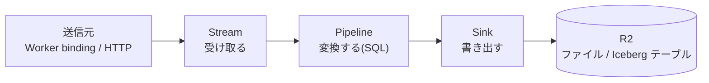
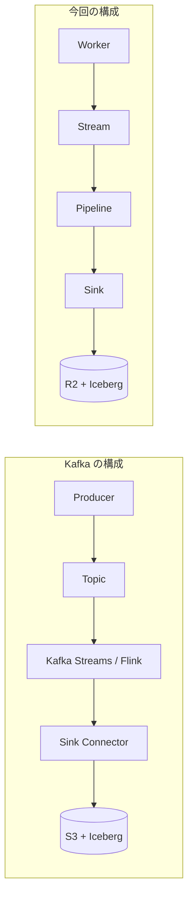
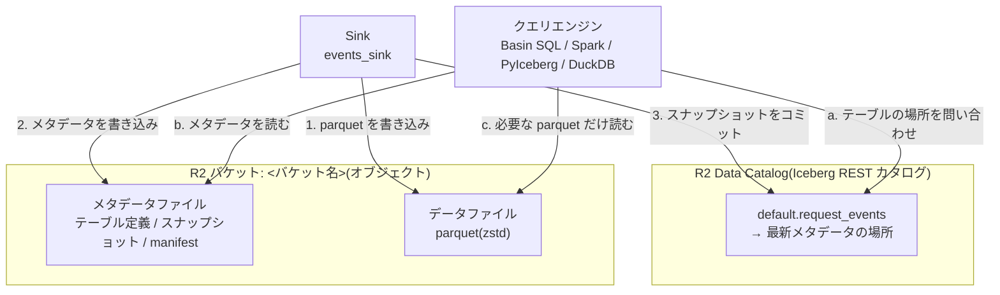
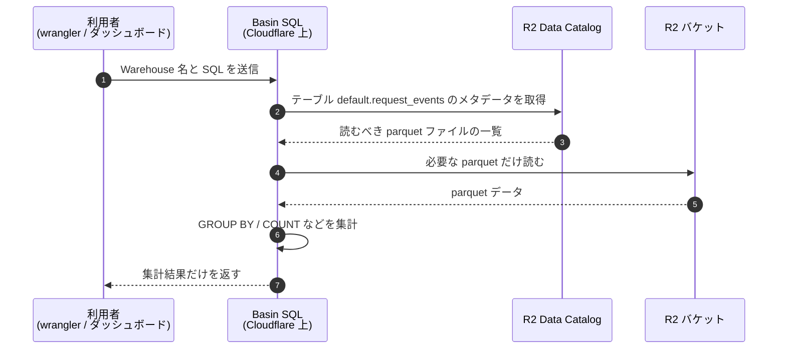
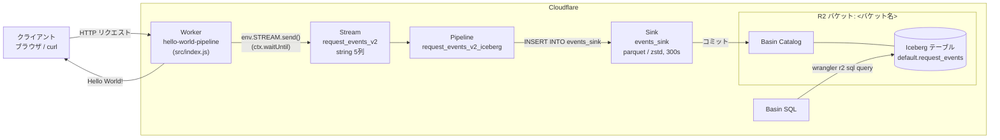
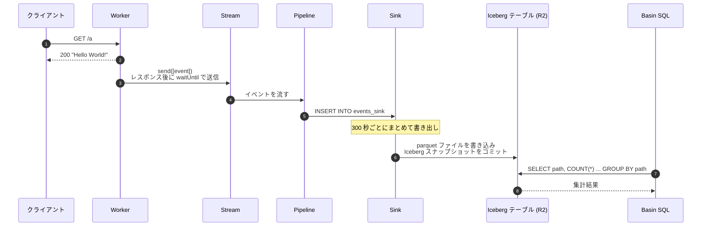

# hello-world-pipeline アーキテクチャとフロー

Cloudflare Workers で受けたリクエストをイベントとして Pipelines に送り、R2 上の Iceberg テーブルに蓄積して Basin SQL で集計する構成。

## Stream / Pipeline / Sink とは

Cloudflare Pipelines は、データを「受け取る」「変換する」「書き出す」の3つの部品に分けて扱う。それぞれ独立したリソースとして作成し、Pipeline が Stream と Sink をつなぐ。



### Stream: 受け取る

イベントの受け口。データベースでいえば、書き込み専用のテーブルのようなもの。

- **送り方**: Worker からは binding(`env.STREAM.send([...])`)で送る。HTTP エンドポイント(`https://<stream ID>.ingest.cloudflare.com`)に API トークン付きで POST することもできる。
- **スキーマ**: 作成時に列名と型を決められる。スキーマに合わないレコードは受け付けられない。
- **役割の範囲**: 受け取ったデータを一時的に保持するだけで、自分では保存先を持たない。Pipeline がつながっていなければ、データはどこにも書き出されない。

このプロジェクトでは `request_events_v2` が、`timestamp`・`method`・`path`・`user_agent`・`country`(すべて string)の5列のスキーマを持つ。

### Pipeline: 変換する

Stream から Sink へデータを流す処理。中身は1本の SQL で、`INSERT INTO <sink> SELECT ... FROM <stream>` の形で書く。

- **できること**: 列の選択・名前の変更・計算、`WHERE` での絞り込みなど、1行ずつの変換。セミコロンで区切れば、1つの Pipeline から複数の Sink に書き出せる。
- **制約**: 作成後に SQL を変更できない。変えたいときは削除して作り直す。
- **注意点**: SQL の文法チェックは作成時に通っても、実行時に値が NULL になることがある。今回 json 列の展開で起きた問題がこれにあたる(末尾の補足を参照)。

このプロジェクトでは `request_events_v2_iceberg` が、変換せずに5列をそのまま `events_sink` へ渡している。

### Sink: 書き出す

データの最終的な保存先の設定。どのバケットに、どの形式で、どのくらいの頻度で書くかを決める。

- **種類**:
  - `r2`: R2 バケットに JSON や parquet のファイルとして書き出す。ファイルが並ぶだけなので、SQL で直接集計できない。
  - `r2-data-catalog`: R2 Data Catalog 上の Apache Iceberg テーブルとして書き出す。Basin SQL や Spark などからテーブルとして問い合わせられる。
- **書き出しのタイミング**: データは一定時間(既定は300秒)か一定サイズごとにまとめてファイルになる。送ってからクエリで見えるまで数分かかるのはこのため。
- **認証**: `r2-data-catalog` の Sink は、カタログに書き込むための API トークン(`--catalog-token`)が必要。

このプロジェクトでは `events_sink` が、`<バケット名>` バケットの Iceberg テーブル `default.request_events` に parquet(zstd 圧縮)で300秒ごとに書き出す。

### 3つを分けている理由

- **送信側を変えずに済む**: 保存先や変換を変えても、Worker が送る Stream は同じままでよい。
- **組み合わせが自由**: 1つの Stream から複数の Pipeline で別々の Sink に書き出すなど、構成を柔軟に組める。
- **入れ替えの手順**: 今回の Sink の切り替え(`r2` から `r2-data-catalog`)でも、Stream と Worker は変えずに、新しい Sink と Pipeline を作って古いものを消すだけで済んだ。

### Kafka との対応

Kafka に近い役割をしているのは **Stream** で、**Worker はデータを送る側(Kafka でいう Producer)** である。

| Kafka の構成 | 今回の構成 | 役割 |
| --- | --- | --- |
| Producer | Worker(`env.STREAM.send()`) | イベントを作って送る |
| Topic(ブローカー) | Stream `request_events_v2` | イベントを受け取って一時的に保持する |
| Kafka Streams / Flink などの変換処理 | Pipeline `request_events_v2_iceberg` | SQL で変換して流す |
| Kafka Connect の Sink Connector | Sink `events_sink` | 外部ストレージに書き出す |
| 保存先(S3 + Iceberg など) | R2 + Iceberg テーブル | データを蓄積する |



Kafka と違う点:

- **自分で読み出せない**: Kafka の Topic は、Consumer を自分で書いて好きなように読める。Stream を読めるのは Pipeline だけで、アプリから直接 consume する仕組みはない。
- **用途が限られる**: Kafka は、サービス間のメッセージング・リアルタイム処理・ログ集約など、何にでも使える汎用の基盤である。Stream は「取り込んで、変換して、R2 に貯める」ための入口に特化している。
- **運用が不要**: ブローカーやパーティション、Consumer Group の管理がいらない。スキーマの検証も Stream が自分で行う。Kafka なら Schema Registry を別に用意するところである。

「メッセージを受け取って、Worker が1件ずつ処理する」という Kafka の Consumer に近い使い方をしたいなら、**Cloudflare Queues** のほうが向いている。Pipelines は分析用データを R2 に貯めるための仕組みで、Queues はアプリ間で非同期に処理するための仕組み、と使い分ける。

Stream 内部での保持期間や、データの再読み込み(Kafka のオフセットを巻き戻すような操作)ができるかは未確認。

## R2 上の Iceberg レイクハウス

この構成では、R2 バケットの上に Apache Iceberg のレイクハウスが乗っている。R2 自体はファイルをオブジェクトとして置いているだけで、それをテーブルとして読めるようにしているのが Iceberg の形式とカタログである。

### 層ごとの役割

| 層 | このプロジェクトでの実体 | 役割 |
| --- | --- | --- |
| ストレージ | R2 バケット `<バケット名>` | データファイルとメタデータファイルを、ただのオブジェクトとして保存する |
| テーブル形式 | Apache Iceberg | ファイルの集まりを、スキーマ・スナップショット・パーティションを持つ「テーブル」として扱えるようにする |
| カタログ | R2 Data Catalog | 「テーブル `default.request_events` の最新状態はこのメタデータファイル」という対応を管理する(Iceberg REST カタログ) |
| 書き込み | Pipelines の Sink `events_sink` | parquet ファイルを書き、新しいスナップショットをカタログにコミットする |
| クエリ | Basin SQL(Spark・PyIceberg・DuckDB なども可) | カタログに問い合わせて、読むべき parquet ファイルを特定して読む |



### バケットの中にあるもの

- **データファイル**: 行データが入った parquet ファイル。
- **メタデータファイル**: テーブル定義、スナップショットの一覧、「どのスナップショットがどのデータファイルからなるか」を記録した manifest。

Sink が書き出すたびに、新しい parquet と新しいスナップショットが追加される。読む側はカタログが指す最新のスナップショットだけを見るので、書き込み途中のファイルを読んでしまうことはない。

### レイクハウスと呼べる理由

- **データレイクの性質**: 安いオブジェクトストレージ(R2)に、オープンな形式(parquet と Iceberg)でデータを置く。
- **データウェアハウスの性質**: スキーマ、スナップショット単位のトランザクション、SQL での集計ができる。
- **エンジンを選ばない**: 形式がオープンなので、同じテーブルを Basin SQL 以外のエンジンからも、Catalog URI とトークンを使って読める。

| 項目 | 値 |
| --- | --- |
| Catalog URI | `https://catalog.cloudflarestorage.com/<アカウント ID>/<バケット名>` |
| Warehouse | `<アカウント ID>_<バケット名>` |
| テーブル | `default.request_events` |

### 確認できていること

- `wrangler r2 bucket catalog enable` の実行時に、上の Catalog URI と Warehouse が発行された。
- Basin SQL の実行結果に `Read 16.3 kB across 10 files from R2` と出ており、クエリが R2 上の複数ファイルを読んでテーブルとして集計している。
- バケット内のオブジェクトの実際のパスやファイル名は未確認。wrangler にオブジェクト一覧のコマンドがないため、中身はダッシュボードの R2 → `<バケット名>` で確認する。

## SQL の集計はだれがどこでやるか

集計を実行しているのは **Basin SQL(R2 SQL)** で、場所は **Cloudflare のネットワーク上**である。手元の PC や Worker で集計しているわけではない。

### 役割の分担

| 役割 | だれ・どこで | やっていること |
| --- | --- | --- |
| クエリを投げる | 利用者。手元の `wrangler r2 sql query`、ダッシュボードの SQL エディタ、REST API のどれか | SQL 文を Cloudflare に送り、結果を受け取って表示するだけ |
| 集計を実行する | **Basin SQL**(Cloudflare のサーバーレスな分散クエリエンジン) | `GROUP BY` や `COUNT` などの計算をすべて行う |
| どのファイルを読むか決める | R2 Data Catalog の Iceberg メタデータ | テーブルを構成する parquet ファイルの一覧を渡す。条件に合わないファイルは読まずに済ませる |
| データを置いておく | R2 バケット | parquet ファイルを保存しているだけで、計算はしない |

### 流れ



クエリの実行結果に出る `Read 16.4 kB across 10 files from R2` は、手順4で Basin SQL が R2 から読んだ量である。

### 集計しないもの

- **Worker**: イベントを送るだけ。
- **Pipeline**: 1行ずつの変換(列の選択、絞り込みなど)だけで、`GROUP BY` のような集計はしない。このプロジェクトでは列をそのまま流しているだけ。

Spark・DuckDB・PyIceberg などのほかのエンジンを使う場合は、そのエンジンが動いている場所(手元の PC など)で集計することになる。

## 構成要素

| 種別 | 名前 | ID / 値 | 役割 |
| --- | --- | --- | --- |
| Worker | `hello-world-pipeline` | `https://hello-world-pipeline.<サブドメイン>.workers.dev` | リクエストに `Hello World!` を返し、イベントを stream に送信 |
| Stream | `request_events_v2` | `npx wrangler pipelines streams list` で確認 | イベントの受け口。スキーマは `stream-schema.json`(string 5列) |
| Pipeline | `request_events_v2_iceberg` | `npx wrangler pipelines list` で確認 | stream の列をそのまま sink へ書き込み |
| Sink | `events_sink` | `npx wrangler pipelines sinks list` で確認 | Basin Catalog(Iceberg)へ parquet / zstd で書き出し。300 秒ごと |
| R2 バケット | `<バケット名>` | Data Catalog 有効 | Iceberg テーブル `default.request_events` の保存先 |
| Warehouse | — | `<アカウント ID>_<バケット名>` | Basin SQL の問い合わせ先 |

## アーキテクチャ図



## リクエストからデータ確認までのフロー



## データの形

Worker が送るイベント(`src/index.js`):

```json
[{
  "timestamp": "2026-10-13T13:31:00.000Z",
  "method": "GET",
  "path": "/a",
  "user_agent": "curl/8.x",
  "country": "JP"
}]
```

Pipeline の SQL:

```sql
INSERT INTO events_sink
SELECT timestamp, method, path, user_agent, country
FROM request_events_v2
```

Iceberg テーブル `default.request_events` の列:

| 列 | 型 | 備考 |
| --- | --- | --- |
| `__ingest_ts` | timestamp | Pipelines が付与する取り込み時刻 |
| `timestamp` | string | Worker で生成した ISO 8601 時刻 |
| `method` | string | |
| `path` | string | |
| `user_agent` | string | null 可 |
| `country` | string | null 可 |

## 設定(`wrangler.jsonc`)

```jsonc
"pipelines": [
	{
		"stream": "<Stream ID>",
		"binding": "STREAM",
	},
],
```

`npm run dev` では `env.STREAM` はローカルのモックになり、本物の stream には送られない。R2 まで流すには `npm run deploy` が必要。

## 認証

| 用途 | 認証方法 |
| --- | --- |
| wrangler の操作(deploy, pipelines, r2) | `wrangler login` の OAuth トークン |
| Sink から Basin Catalog への書き込み | アカウント API トークン(Admin Read & Write)を `--catalog-token` で指定 |
| Basin SQL の問い合わせ | 同じトークンを環境変数 `WRANGLER_BASIN_SQL_AUTH_TOKEN` で指定 |

トークンはプロジェクト直下の `.catalog_token` に保存し、`.gitignore` 済み。

## 集計クエリの例

```sh
WRANGLER_BASIN_SQL_AUTH_TOKEN="$(cat .catalog_token)" \
npx wrangler r2 sql query <アカウント ID>_<バケット名> \
  "SELECT path, COUNT(*) AS hits FROM default.request_events WHERE path IS NOT NULL GROUP BY path ORDER BY hits DESC"
```

## 補足: json スキーマをやめた理由

最初は stream を `value: json` の1列で作り、pipeline の SQL で `json_get_str` や `->>` を使って列に展開していた。しかしどちらでも列がすべて NULL になったため、stream を列ごとの string スキーマで作り直した。そのときの12行は `path` が NULL のままテーブルに残っているので、集計では `WHERE path IS NOT NULL` で除外する。
